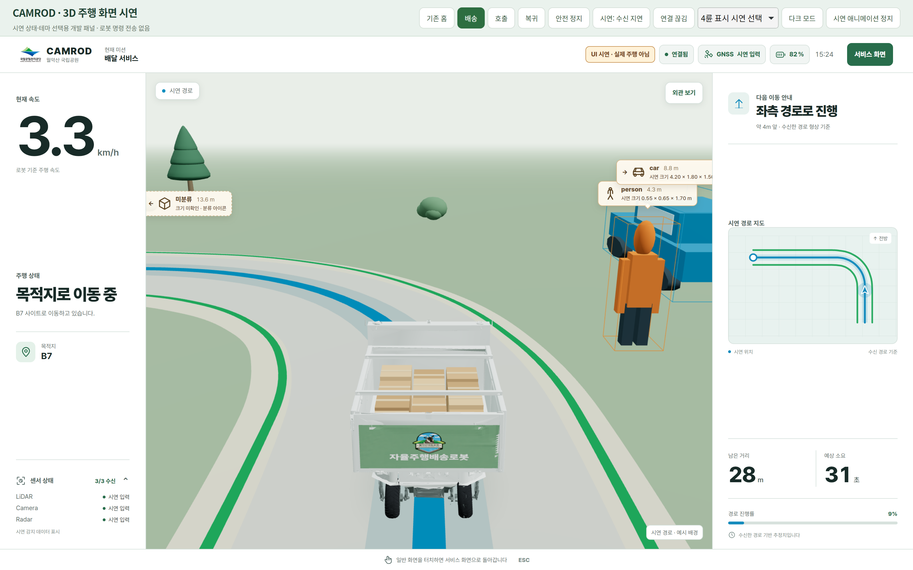

# v2.3.1 — Navigation model deployment and default kiosk compatibility

Date: 2026-10-06. Base: `develop` / `v2.3.0` (`0387c566`).

## What is fixed

The Ranger GLB and livery textures were already tracked in Git. A successful
checkout alone did not guarantee that the React build and ROS install contained
the same assets, or that the default WebKit kiosk could render the 3D view.
This release closes those build, serving and rendering gaps.

| Area | Change | Existing behavior retained |
| --- | --- | --- |
| `colcon_build.sh` | Resolve UI selection with the colcon package graph; validate source/build/install assets, including dependency-selected builds | Existing build workflow and non-UI package configuration |
| UI packaging | Reject an incomplete build before publishing; guard direct setuptools/colcon installs | Metadata-only package discovery still works on a fresh checkout |
| HTTP serving | Missing model/image/JS files return 404, with GET/HEAD support; require a real `index.html` | SPA routes, cache policy and symlink installs |
| Native kiosk | Acquire WebGL only while a navigation view is mounted; wait for acknowledgement before renderer creation | Default engine stays WebKit; WebGL is off on the service screen and reset on reload/close |
| Frontend | Document-scoped lease IDs prevent stale cleanup/replies affecting a newer view; use the existing park logo as favicon | Normal browser rendering and existing service UI |

Implementation and regression-test comments use `HH_261006 - ...` in English.
No changes to driving control, docking, battery policy, GNSS/TF, camera capture
defaults, AprilTag parameters, or CARLA-specific integration are part of this release.
The existing `v2.3.0` tag is not moved.

## Build on another machine

From the CAMROD source root inside the normal ROS workspace:

```bash
git fetch origin develop --tags
git switch develop
git pull --ff-only origin develop
./colcon_build.sh --packages-select camrod_ui
source ../install/setup.bash
```

The existing workspace dependencies, ROS environment, Node.js/npm and native
WebKit runtime must be available. The model is served by the UI backend from
the installed package; it is not fetched from a developer's home directory or
another PC. For an exact release checkout, use a separate clean checkout of
`v2.3.1` instead of replacing local work.

To verify all published files explicitly:

```bash
python3 camrod_ui/scripts/verify_frontend_assets.py \
  --frontend camrod_ui/camrod_ui_robot/assets/frontend \
  --build camrod_ui/camrod_ui_robot/assets/frontend/build \
  --installed ../install/camrod_ui/share/camrod_ui/camrod_ui_robot/assets/frontend/build
```

A missing asset is now an error, not a silently successful deployment. The
check covers 58 public assets in this revision plus the referenced JS/CSS build.
The Ranger GLB is 5,576,620 bytes; SHA-256:
`da468915fa41de59955c0d297ccfadb0002248cac8f7f60414a7e731cfa8d202`.

## Validation

Validated on the pure `develop` release worktree, not by importing simulator-only tests:

- Python UI tests and build-policy tests: **784 passed**.
- React tests: **16 suites / 296 tests passed**.
- Production React build: successful.
- Isolated `colcon build --packages-select camrod_ui --symlink-install`: successful;
  all 58 public assets and referenced bundles match the installed files.
- Default native WebKitGTK 2.50.4: model and four wrapped faces rendered; returning
  home, reopening navigation and reloading all passed, with no captured JS errors.
- The graphics setting sequence was `false → true → false → true → false → true → false`.
- `git diff --check` and shell syntax checks passed.

The regression suite covers absent/stale model textures, incomplete publication,
selection failures, HTTP asset errors, GET/HEAD behavior, and navigation graphics
acquire/release/reload behavior.

### Visual evidence

These are captures of the real native WebKit window using clearly labelled
synthetic preview data. They verify UI rendering, not autonomous driving or
physical-robot operation. No robot commands were transmitted.



[Animated navigation and exterior-view capture](evidence/v231_model_portability_20261006/navigation_webkit.gif)
· [Lifecycle check results](evidence/v231_model_portability_20261006/webkit_lifecycle.json)
· [Restored service screen](evidence/v231_model_portability_20261006/home_webkit.png)
· [After reopening](evidence/v231_model_portability_20261006/navigation_reopened_webkit.png)
· [After reload](evidence/v231_model_portability_20261006/navigation_reloaded_webkit.png)

The bounded read-only capture helper is `camrod_ui/tools/check_webkit_navigation.py`.
It runs the production kiosk code and requires a local frontend server and graphical
session. It does not change the default engine or permanently enable WebGL.

## ARM and rear-container CPU scope

This is a UI portability release, not a camera/AprilTag CPU optimization release.
Existing camera and detector defaults are unchanged. An x86 CARLA sensor-stream
benchmark cannot certify the physical Jetson ARM64 camera container or promise
that its combined CPU usage will be below 100%.

In particular, CPU percentages count one logical core as 100%; 200% represents
approximately two busy cores. Compare the same resolution, observed frame rate,
subscribers, component list and power mode on the actual robot before concluding
that a regression or a reduction occurred. Local rear-container measurements are
reported separately from the model deployment verification.
